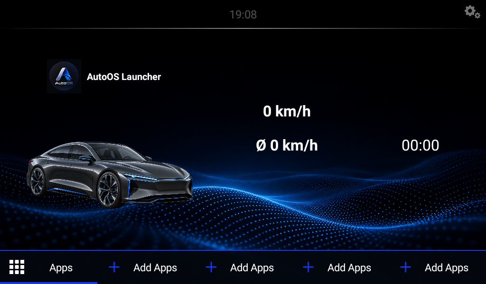
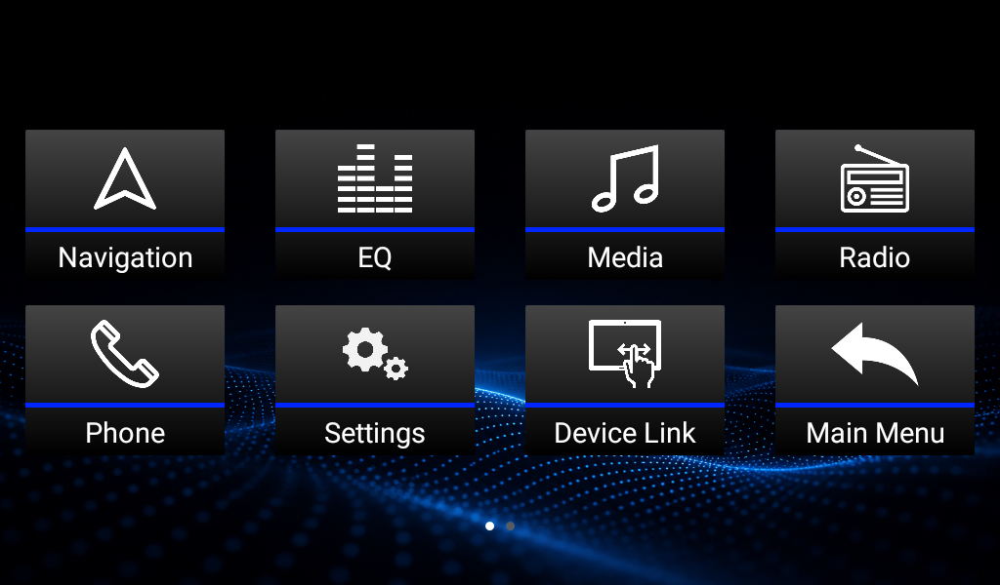
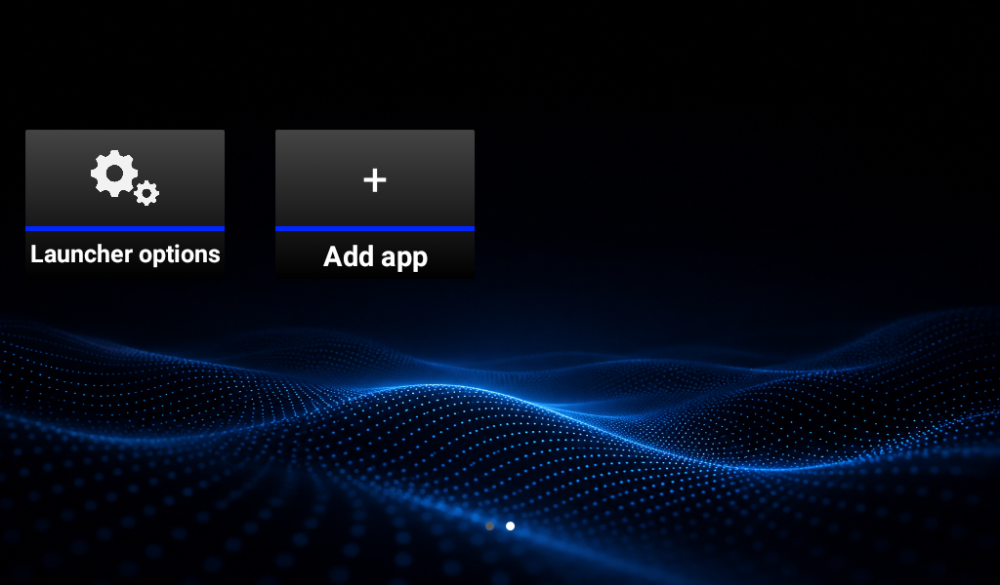
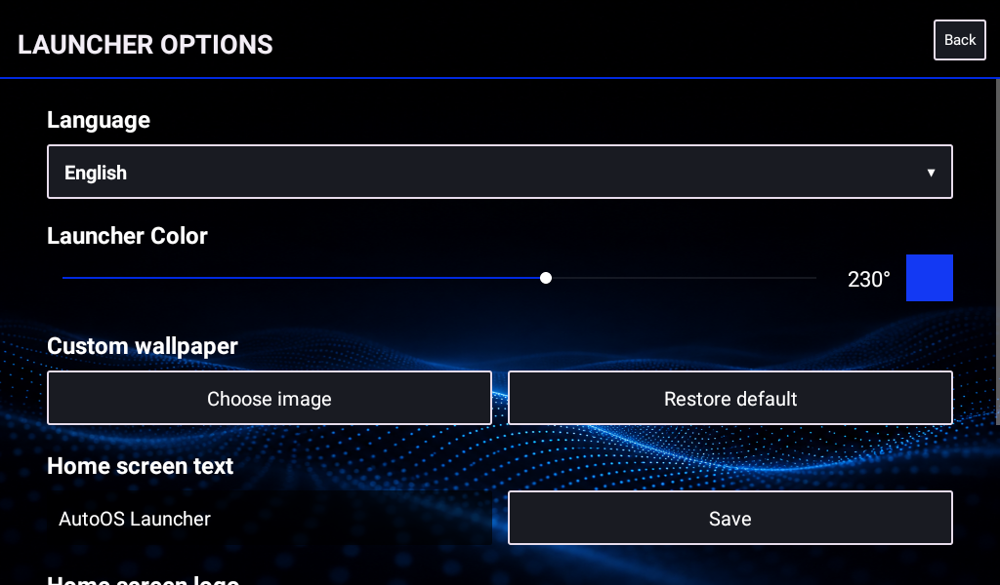

# AutoOS Launcher

> **Distribution:** Free to download. The owner has not granted permission to modify or redistribute the source code or assets. See [REDISTRIBUTION.md](REDISTRIBUTION.md).

AutoOS is a landscape Android launcher designed for car head units. It provides a customizable home screen, an app menu, app shortcuts, GPS speed and trip time, media controls, and a software equalizer for compatible Android audio sessions. All features in this version are free.



## Requirements

- Android 6.0 (API 23) or newer
- Landscape display
- Android Studio with Android SDK 36 and JDK 21

The application ID is `com.autoos.launcher`. Changing from the earlier package ID makes this a separate installation; settings from older installs are not migrated automatically.

## Build

Open this folder in Android Studio and run the `app` configuration, or build from the command line:

```text
gradlew.bat :app:assembleDebug
```

On macOS or Linux, use `./gradlew :app:assembleDebug`. Android Studio creates `local.properties` with your local SDK path. This file and build outputs are ignored by Git.

The release build is intentionally unsigned. To distribute an installable release APK, use **Build → Generate Signed Bundle / APK** in Android Studio with a private signing key that you keep outside this repository.

A signed APK for this snapshot is in the package's adjacent `release-apk` folder. Its signing key is kept outside the GitHub repository. See [PRIVACY.md](PRIVACY.md) for current data-handling notes.

## Features and limits

- The four home screen shortcut slots and the Apps menu entries can be assigned to installed apps.
- Launcher Options controls language, wallpaper, logo, vehicle image, home text, and accent color.
- GPS speed requires location permission and a location fix.
- The EQ acts on compatible Android audio sessions. It does not control every head unit's radio, Bluetooth call audio, or proprietary hardware DSP.
- Phone and Device Link behavior depends on apps and capabilities available on the device.





## Redistribution status

The project owner stated that they wrote the older source project and generated the retained blue-wave wallpaper and menu icons with ChatGPT. Unknown-license font binaries were removed. See [ASSET_ORIGIN.md](ASSET_ORIGIN.md) and [PUBLIC_RELEASE_CHECKLIST.md](PUBLIC_RELEASE_CHECKLIST.md).

The repository is source available for free download. It is not offered under an open-source license. See [REDISTRIBUTION.md](REDISTRIBUTION.md).
